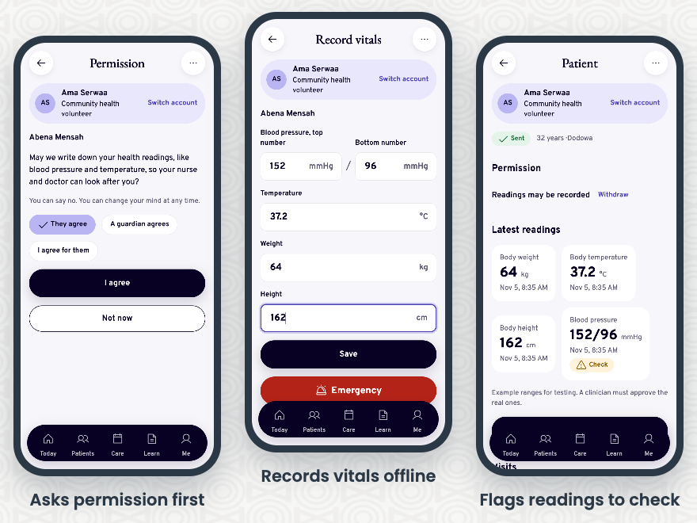
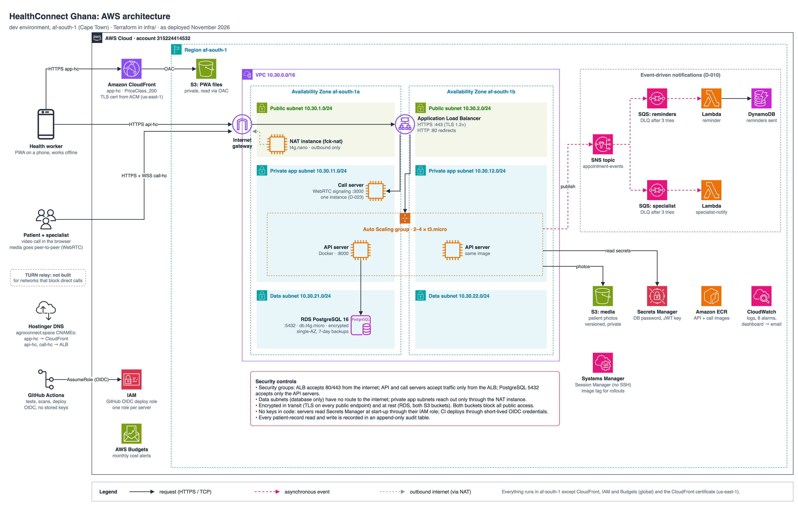

# HealthConnect Ghana — Group 3 (Highlanders)

ICS 534 Cloud Computing · PROSIT 2 · Joseph Etse · Eugene Sewor · Elise Kennedy-Angbo · Perfect Avugla

## The app

Three screens from the community health volunteer's visit to a patient, in order: **ask permission first**, then
**record vitals** (this works with no signal and syncs later), then the patient's record, which **flags a reading for a
clinician to check**. People and readings are made up; screens from 5 November.

These are three of about 60 screens. HealthConnect is one installable web app (PWA) with eight roles, and each person
sees only their own role's screens after signing in. All data is synthetic.

| Role | What they do in the app | Status |
|---|---|---|
| **Community health volunteer** | Register patients, record permission and vitals offline, sync when there's signal, book visits, join video visits, refer, raise an emergency, surveys, mothers and babies, learning | Built. Learning shows sample content only |
| **Patient** | Their visits, video visits, their permissions, paying the fee, health insurance, learning | Built. Fees run in votex365's test mode (no real money); insurance plans and the NHIS check are simulated |
| **Clinician** | Today's patients, patient records, shared images, video visits, referrals and emergencies, prescribing | Built |
| **Pharmacist** | Verify a prescription, queue, stock | Built. One-time dispense enforced by the database; the pharmacy network is simulated |
| **Traditional healer** | Their patients, referrals with consent, remedies in use | Built on synthetic data |
| **Ghana Health Service official** | Surveillance dashboard, disease map, outbreak alerts, policy and SDG 3 views | Built on synthetic data. Forecasts are four-week averages, labelled as estimates |
| **Health centre admin** | Staff, stock, training, reports for their own facility | Built. FHIR, DHIS2 and WHO exports are sandbox downloads, not validated; training shows sample content |
| **Platform admin** | Users, roles, audit log, revenue, settings | Built. Settings are read-only in this version |

The app signs in and syncs against the live API. A labelled "Test mode" switch shows sample data instead, for demos without a network.

## Architecture

What runs where, as deployed in `af-south-1`. To edit, open [`docs/architecture-healthconnect.drawio`](docs/architecture-healthconnect.drawio) in draw.io. Infrastructure details: [`infra/README.md`](infra/README.md).

## Try it live

| What | Link | Notes |
|---|---|---|
| **The app** (PWA) | https://app-hc.agroconnect.space | Open on a phone or laptop; "Add to home screen" installs it, and it keeps working offline |
| **Video call page** | https://call-hc.agroconnect.space | Open the same room link in two browsers; video goes directly between them |
| **API health** | https://api-hc.agroconnect.space/health · [`/ready`](https://api-hc.agroconnect.space/ready) | `/ready` also checks the database |

**Signing in:** one test account per role, all with synthetic data: `chv`, `patient`, `clinician`, `pharmacist`,
`healer`, `ghs` (surveillance dashboard), `facility_admin`, `platform_admin`. The password is not in this public repo;
the team shares it with the lecturer directly.

Everything runs in AWS `af-south-1` (Cape Town). No real patient data is stored anywhere.

## What's built, and what isn't

Built and live: offline records with sync and conflict handling; sign-in for eight roles; video visits (with consented
call recording kept on the doctor's phone); referrals with suggested priority and emergency escalation; prescriptions
with fraud flags and one-time dispensing; surveillance and outbreak alerts; maternal and child care and surveys;
healer referrals and medicine stock; facility admin and the SDG 3 dashboard; English and Twi.

Simulated or test mode: mobile-money fees (votex365 test mode), health insurance and NHIS, the GMDC licence check,
the pharmacy network, and the FHIR, DHIS2 and WHO exports.

Not built: the health education library and certificates (needs media uploads to S3), and patient fingerprint
matching. The final report explains each choice and the next step.

## What's in this repository

| Path | What it holds |
|---|---|
| [`frontend/`](./frontend/) | The PWA (React, offline storage, sync, eight roles) |
| [`backend/`](./backend/) | The API: `patient-record-service`, Node/TypeScript |
| [`db/`](./db/) | PostgreSQL migrations 001–014 (FHIR-aligned) and their tests |
| [`functions/`](./functions/) | Lambda functions for the event layer (SNS → SQS → Lambda) |
| [`infra/`](./infra/) | Terraform for AWS `af-south-1` |
| [`docs/`](./docs/README.md) | Decisions (ADRs), FHIR mapping, data decisions, admin guide, architecture diagram, AI-tools usage |
| [`evidence/`](./evidence/README.md) | Lab and final evidence: screenshots, outputs and the scripts that produced them |
| [`learnings/`](./learnings/README.md) | How each part works, in plain words |
| [`knowledge/`](./knowledge/README.md) | Background: the brief, labs, lectures, Prosit 1 |
| [`PLAN.md`](./PLAN.md) | The full plan we worked from, stage by stage |

How we worked: [`CONTRIBUTING.md`](./CONTRIBUTING.md). AI use is declared in
[`docs/ai-tools-usage.md`](./docs/ai-tools-usage.md), signed by all four members.
