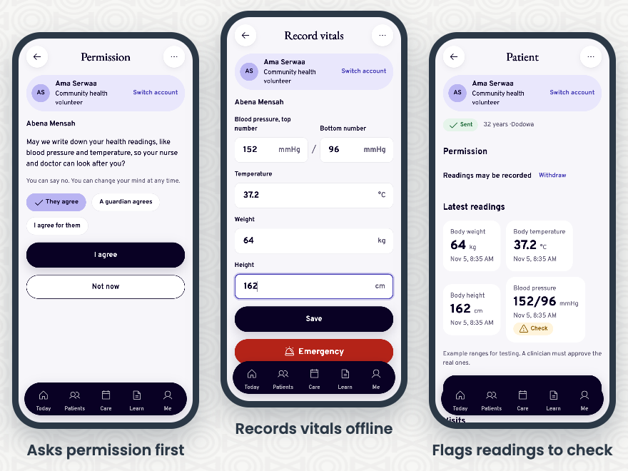
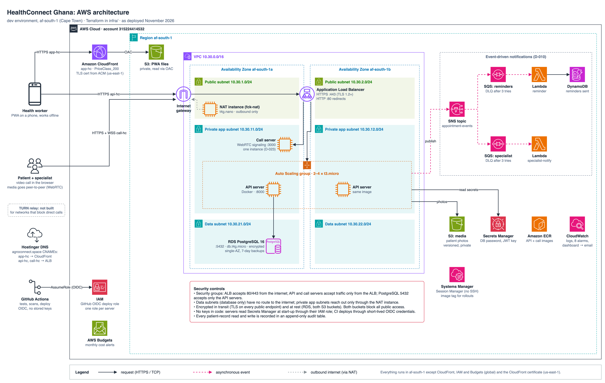

# HealthConnect Ghana — Group 3 (Highlanders)

ICS 534 Cloud Computing · PROSIT 2 · Joseph Etse · Eugene Sewor · Elise Kennedy-Angbo · Perfect Avugla

## The app

Three screens from the community health volunteer's visit to a patient, in order: **ask permission first**, then
**record vitals** (this works with no signal and syncs later), then the patient's record, which **flags a reading for a
clinician to check**. People and readings are made up; screens from 5 November.

These are three of about 60 screens. HealthConnect is one installable web app (PWA) with eight roles, and each person
sees only their own role's screens after signing in:

| Role | What they do in the app | State |
|---|---|---|
| **Community health volunteer** | Register patients, record permission and vitals offline, sync when there's signal, book visits, join video visits, refer, raise an emergency, surveys, mothers and babies, learning | Working with live data: patients, permission, vitals, sync, booking, video visits, photos. The rest are previews |
| **Patient** | Their visits, video visits, their permissions, paying the fee, health insurance, learning | Video visits work; the rest are previews |
| **Clinician** | Today's patients, patient records, shared images, video visits, referrals and emergencies, prescribing | Video visits work; prescribing is in review (#57) |
| **Pharmacist** | Verify a prescription, queue, stock | In review (#57) |
| **Traditional healer** | Their patients, remedies in use | Preview |
| **Ghana Health Service official** | Surveillance dashboard, disease map, outbreak alerts, policy and SDG 3 views | Surveillance, map and alerts work with synthetic data; policy and SDG views are previews |
| **Health centre admin** | Staff, stock, training, reports for their own facility | Preview |
| **Platform admin** | Users, roles, audit log, settings | In review (#59) |

"Preview" screens show sample rows and say so on the screen ("Test mode"); they are connected to the API task by task
(see the task tables below).

## Architecture

What runs where, as deployed in `af-south-1`. To edit, open [`docs/architecture-healthconnect.drawio`](docs/architecture-healthconnect.drawio) in draw.io. Infrastructure details: [`infra/README.md`](infra/README.md).

## Try it live

| What | Link | Notes |
|---|---|---|
| **The app** (PWA) | https://app-hc.agroconnect.space | Open on a phone or laptop; "Add to home screen" installs it, and it keeps working offline |
| **Video call page** | https://call-hc.agroconnect.space | Open the same room link in two browsers; video goes directly between them |
| **API health** | https://api-hc.agroconnect.space/health · [`/ready`](https://api-hc.agroconnect.space/ready) | `/ready` also checks the database |

**Signing in:** one test account per role, all with synthetic data: `chv`, `patient`, `clinician`, `pharmacist`,
`healer`, `ghs` (surveillance dashboard), `facility_admin`, `platform_admin`. The password is not in this public repo;
the team shares it with the lecturer directly.

Everything runs in AWS `af-south-1` (Cape Town). No real patient data is stored anywhere.

## Everything to do now, and who does it

_Updated 11 Nov 2026. Every feature PR up to #83 is merged and deployed; RDS has migrations 001–014 (Eugene, 11 Nov). Midsem Thu 12 Nov. Working deadline Fri 13 Nov (being confirmed). Full plan, with evidence file names: [`PLAN.md`](./PLAN.md#final-sprint-6-to-13-nov-one-week-to-finish-lab-8-and-prosit-2)._

### Joseph

| Task | Due | Tier | Status |
|---|---|---|---|
| X1 Ask the facilitator: final dates and format, Lab 8 session and partner team | Fri 6 | 1 | 🟢 Ready |
| FB-11 Languages (English and Twi; Ewe, Dagbani, Hausa files ready), 200% text size | Tue 10 | 3 | 🔄 Being built (taken over from Perfect); Twi needs a native speaker's check |
| F2 Demo recording end to end, role screenshots for `evidence/final/` | Fri 13 | 1 | 🟢 Ready (all features live) |
| F1 Final report (finished Fri 13) | Fri 13 | 1 | 🔄 Draft in Drive, `prosit 2/Final/`; marked text waits on each owner |

### Eugene

| Task | Due | Tier | Status |
|---|---|---|---|
| L6-B1b KMS key, `rds.force_ssl`, HTTPS-only bucket | Sat 7 | 1 | 🟢 Ready |
| L6-X Why the failover dropped requests; L8-C resource audit | Sun 8 | 1, 2 | 🟢 Ready |
| E2 Load test: 1,000 users, 50,000 records | Tue 10 | 1 | 🟢 Ready |
| E3 Uptime case: alarms, health checks, tested restore | Tue 10 | 1 | 🟢 Ready |
| SVC-2 Media uploads to S3; FB-8 education library | Tue 10 | 2, 3 | 🟢 Ready (not built; the report can give the design) |
| R-E Report section: architecture, cost, load test, TURN, platform choice | Wed 11 | 1 | 🔄 Draft in the report; Eugene to confirm |

### Elise

| Task | Due | Tier | Status |
|---|---|---|---|
| R-L Report section: FHIR, minimisation, HIPAA mapping, DHS data, community engagement | Wed 11 | 1 | 🔄 Draft in the report; Elise to confirm |
| L8-B3 Written peer review, 200 words | End of Week 8 | 1 | ⛔ Needs the Lab 8 session |

### Perfect

| Task | Due | Tier | Status |
|---|---|---|---|
| P1 Phone checks on the live app; airplane-mode demo; tick the checklist | Sat 7 | 1 | 🟢 Ready |
| L8-A1 Check the redrawn diagram (#63, consolidated version in `evidence/lab9/`) | Before the session | 1 | 🟢 Ready |
| R-P Report section: PWA, offline, WebRTC on 2G and 3G, accessibility | Wed 11 | 1 | 🔄 Draft in the report; Perfect to confirm |
| L8-B2 Before and after diagrams | Session day | 1 | ⛔ Needs the Lab 8 session |

### Everyone

| Task | Due | Status |
|---|---|---|
| L8-B1 The Lab 8 session: present, answer, review, take notes | Session day | ⛔ Date from X1 |
| Lab 9 package: agree the sustainability and retention text; add the spend row to the cost template | Fri 13 | 🔄 Draft PDF in Drive, `prosit 2/Final/` |
| Each person's paragraph in the report, in your own words | Fri 13 | 🟢 Ready |
| F3 Peer assessment and AI sign-off | Fri 13 | ⛔ Needs F1 |

**Every day:** check in by 21:00 (done, next, stuck). Approve PRs within 3 hours. Save evidence as you go: [`evidence/final/`](./evidence/README.md#final-sprint-evidence). Progress: run `npm run progress` in `frontend/`, or see [`BUILD-CHECKLIST.md`](./BUILD-CHECKLIST.md).

---

Everything else: [`PLAN.md`](./PLAN.md) (all stages, done and to come) · [`CONTRIBUTING.md`](./CONTRIBUTING.md) (how we work, repo map) · [`AGENTS.md`](./AGENTS.md) (for coding assistants).
**This page lists only what's open now.** When a task changes state, update it here and in `PLAN.md` in the same PR; remove it from here once it's done.
